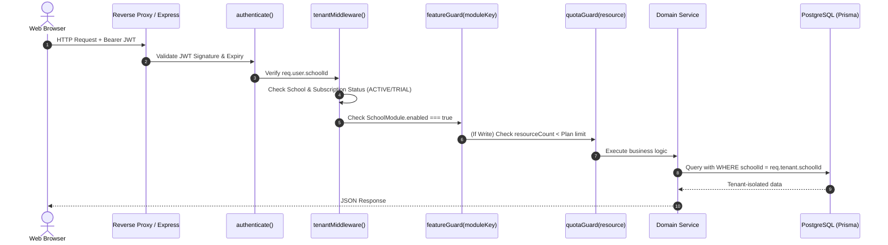
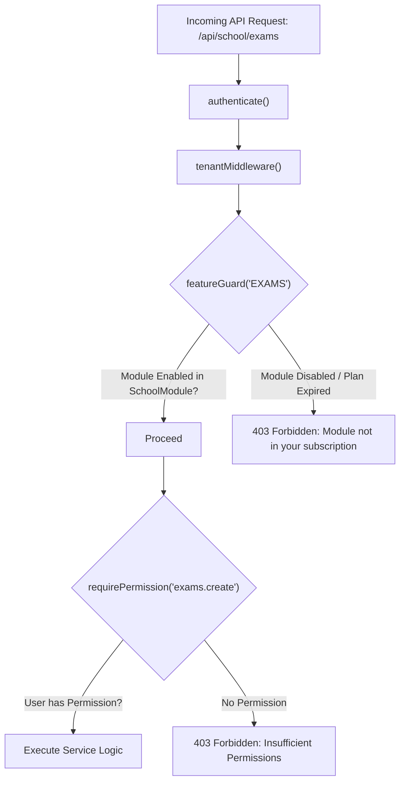
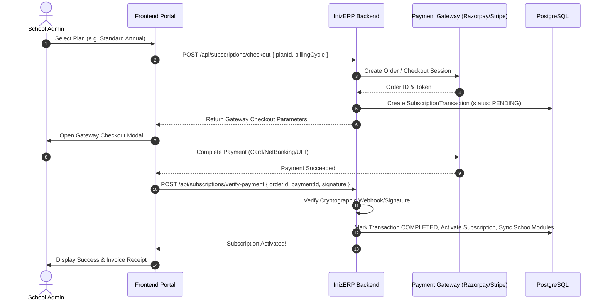
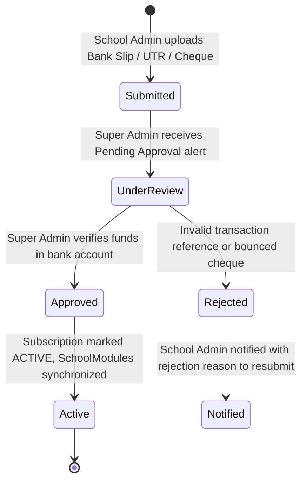
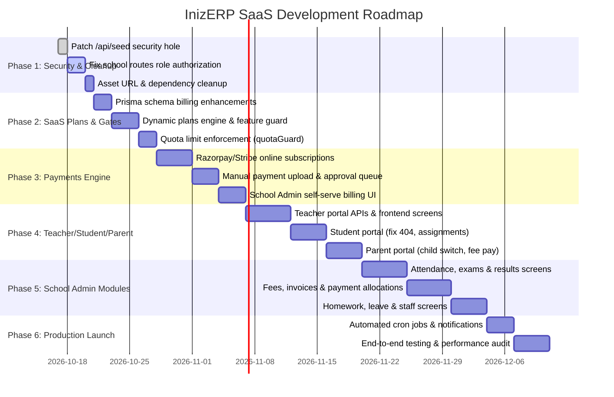

# INIZERP — Multi-Tenant School Management SaaS: Implementation Plan & Technical Roadmap

**Document Version:** 1.0.0  
**Target Architecture:** Multi-Tenant SaaS (PERN / Modern Full-Stack TypeScript)  
**Target Roles:** Super Admin, School Admin, Teacher, Student, Parent  
**Pricing & Billing:** Dynamic 3-Tier Plans (Basic, Standard, Premium) + Online & Offline Payment Gateways

---

## 1. Architectural Blueprint & Tenancy Model

### 1.1 Five Role Personas & Separation of Concerns

```mermaid
graph TD
    subgraph Platform_Level ["Platform Governance"]
        SA["Super Admin"]
    end

    subgraph Tenant_Level ["Tenant School (School Admin)"]           
        SCH["School Admin / Owner"]
    end

    subgraph Stakeholders ["School Stakeholders"]
        T["Teacher"]
        ST["Student"]
        P["Parent"]
    end

    SA -->|"Manages Schools, Plans & Subscriptions"| SCH
    SCH -->|"Manages Academics, Fees, Staff & Schedules"| T
    SCH -->|"Enrolls & Bills"| ST
    SCH -->|"Communicates & Invoices"| P
    T -->|"Marks Attendance, Assigns Homework & Grades"| ST
    ST -->|"Submits Work, Views Schedule & Results"| T
    P -->|"Monitors Child, Pays Fees & Applies Leave"| ST
```

1. **Super Admin (Platform Owner):**
   - SaaS business governance: Provision schools, define subscription plans, manage global ERP modules.
   - Review and approve/reject manual subscription payments (bank transfers/cheques).
   - Monitor platform MRR/ARR, tenant analytics, error logs, and system maintenance.
2. **School Admin (Tenant Manager / Principal):**
   - Academic taxonomy: Academic years, classes, sections, subjects, timetables.
   - Campus operations: Student admissions, enrollments, staff management, leave request approvals.
   - Financial ledger: Fee heads, invoice generation, offline payment recording, payment allocation.
   - SaaS self-service: View current subscription, usage quotas (students/teachers count), renew or upgrade plan, pay via online gateway or submit manual payment receipts.
3. **Teacher (Academic Facilitator):**
   - My Classes: View allocated classes, sections, and subject timetables.
   - Student Roster: View enrolled students in assigned classes.
   - Attendance: Record and update daily or period-wise student attendance.
   - Assignments: Create homework with attachments, set deadlines, evaluate submissions, give feedback.
   - Examinations: Input marks, calculate subject grades, submit results for approval.
4. **Student (Learner):**
   - Personalized timetable, daily attendance percentage, upcoming assignments and due dates.
   - Submit homework files and view teacher feedback/marks.
   - Exam schedules, downloadable report cards, pending fee invoices.
5. **Parent (Guardian / Payer):**
   - Multi-child switcher (if more than one child attends the school).
   - View attendance logs, report cards, teacher remarks, and school calendar events.
   - View fee dues, download fee receipts, and pay outstanding school fee invoices online.
   - Submit student leave applications directly to the school administration.

---

### 1.2 Multi-Tenancy Isolation Architecture



- **Tenancy Model:** Logical isolation with Shared Database & Shared Schema using `schoolId` as the primary tenant discriminator.
- **Tenant Enforcement:**
  1. **JWT Payload:** Includes `schoolId` and `role`.
  2. **`tenantMiddleware`:** Attaches `req.tenant = { schoolId }`. For non-Super Admin users, validates that the school is in `ACTIVE` or `TRIAL` status and that the subscription has not expired.
  3. **Data Layer Isolation:** All tenant queries must include `{ where: { schoolId: req.tenant.schoolId } }`. Prisma Client extensions or interactive client wrappers enforce this filter automatically.
  4. **Compound Indexes:** Critical queries are indexed by `[schoolId, id]`, `[schoolId, createdAt]`, and `[schoolId, code]` to guarantee multi-tenant query performance.

---

### 1.3 Database Architecture: PostgreSQL + Prisma vs MongoDB

| Architectural Vector | Existing PostgreSQL + Prisma (Recommended) | MongoDB + Mongoose (Alternative) |
| :--- | :--- | :--- |
| **Relational Integrity** | **Native Foreign Keys & Cascade Deletes** (Students, Classes, Invoices, Payments). | Application-level manual validation; risk of orphaned financial and student records. |
| **ACID Transactions** | **Full Multi-Table ACID Transactions** (Atomic payment allocation across invoices, receipt generation, and ledger updates). | Two-phase commits / Multi-document transactions require replica sets and high memory. |
| **Current Project Progress** | **95% Schema Completed** (50+ models already written, indexed, and migrated in PostgreSQL). | **0% written** (Requires rewriting all models, schemas, aggregations, and migration scripts). |
| **Migration Risk** | **Zero Risk:** Preserves existing working database schema and migrations. | **Extreme Risk:** Complete rewrite of the entire backend data access layer. |

> [!IMPORTANT]
> **Architectural Recommendation:** Retain **PostgreSQL with Prisma ORM**. The data requirements of a School ERP (hierarchical classes, timetables, grade distributions, invoices, payment allocations) are inherently relational. Converting to MongoDB would introduce unnecessary risk and development delays without providing any performance or scalability advantages.

---

## 2. Dynamic Subscription Plans & Feature Matrix

### 2.1 The 3-Tier Plan Strategy

```mermaid
graph LR
    subgraph Basic_Plan ["BASIC TIER"]
        B1["Up to 250 Students"]
        B2["Up to 20 Teachers"]
        B3["Core Academics"]
        B4["Attendance & Timetable"]
        B5["Notices & Events"]
    end

    subgraph Standard_Plan ["STANDARD TIER"]
        S1["Up to 1,000 Students"]
        S2["Up to 75 Teachers"]
        S3["Basic + Exams & Results"]
        S4["Homework & Submissions"]
        S5["Fee Invoicing & Receipts"]
        S6["Leave Management"]
    end

    subgraph Premium_Plan ["PREMIUM TIER"]
        P1["Up to 3,500+ Students"]
        P2["Up to 250 Teachers"]
        P3["Standard + Online Payments"]
        P4["Library, Transport, Hostel"]
        P5["Advanced Financial Reports"]
        P6["Audit Logs & Custom Branding"]
    end

    Basic_Plan -->|Upgrade| Standard_Plan
    Standard_Plan -->|Upgrade| Premium_Plan
```



### 2.2 Dynamic Subscription Feature Matrix

| Functional Module | Module Key | Basic Plan (₹4,999/yr) | Standard Plan (₹14,999/yr) | Premium Plan (₹29,999/yr) |
| :--- | :--- | :---: | :---: | :---: |
| **Maximum Students** | `LIMIT_STUDENTS` | 250 | 1,000 | 3,500 (Configurable) |
| **Maximum Teachers** | `LIMIT_TEACHERS` | 20 | 75 | 250 |
| **Maximum School Admins** | `LIMIT_ADMINS` | 2 | 5 | 15 |
| **Storage Quota** | `LIMIT_STORAGE` | 2 GB | 15 GB | 100 GB |
| **Academic Years & Classes** | `ACADEMICS` | Included | Included | Included |
| **Student Directory & Profiles** | `STUDENTS` | Included | Included | Included |
| **Teacher Directory** | `TEACHERS` | Included | Included | Included |
| **Daily Attendance** | `ATTENDANCE` | Included | Included | Included |
| **Class Timetable Scheduling** | `TIMETABLE` | Included | Included | Included |
| **Announcements & Calendar Events**| `NOTICES` | Included | Included | Included |
| **Examinations & Grading** | `EXAMS` | Locked | Included | Included |
| **Report Cards & Marksheets** | `RESULTS` | Locked | Included | Included |
| **Homework & Online Submissions** | `HOMEWORK` | Locked | Included | Included |
| **Fee Structures & Invoicing** | `FEES` | Locked | Included | Included |
| **Offline Fee Receipts (Cash/Cheque)**| `OFFLINE_PAYMENTS`| Locked | Included | Included |
| **Leave Application Workflow** | `LEAVE_REQUESTS` | Locked | Included | Included |
| **Online School Fee Gateway** | `ONLINE_FEE_COLLECTION`| Locked | Locked | Included |
| **Library Management** | `LIBRARY` | Locked | Locked | Included |
| **Transport & Bus Tracking** | `TRANSPORT` | Locked | Locked | Included |
| **Hostel & Dormitory Allocation** | `HOSTEL` | Locked | Locked | Included |
| **School Custom Domain & Branding**| `CUSTOM_BRANDING`| Locked | Locked | Included |
| **Audit Logs & Export** | `AUDIT_LOGS` | Locked | Locked | Included |
| **Advanced Analytics & Reports** | `REPORTS` | Locked | Locked | Included |

### 2.3 Dynamic Plan Customization
Super Admin can dynamically:
- Create custom plans or edit existing ones (e.g., add a "Starter Free Trial" or "Enterprise Custom").
- Toggle which specific `ERPModule` rows are linked to the plan in `PlanModule`.
- Modify student, teacher, and admin limits.
- When a school subscribes or upgrades, the platform automatically synchronizes the plan's `PlanModule` set into `SchoolModule`.

---

## 3. Feature Access Control & Usage Limits Engine

### 3.1 Two-Tier Access Gatekeeper



#### 1. Backend Feature Guard Middleware (`featureGuard.ts`)
```typescript
export const featureGuard = (moduleKey: string) => {
  return async (req: Request, res: Response, next: NextFunction) => {
    if (req.user?.role === "SUPER_ADMIN") return next();

    const schoolId = req.tenant?.schoolId;
    if (!schoolId) {
      return res.status(403).json({ success: false, message: "School context required" });
    }

    const enabledModule = await prisma.schoolModule.findFirst({
      where: {
        schoolId,
        enabled: true,
        module: { key: moduleKey, isActive: true },
      },
    });

    if (!enabledModule) {
      return res.status(403).json({
        success: false,
        code: "FEATURE_LOCKED",
        message: `The '${moduleKey}' module is not included in your school's subscription plan. Please upgrade to access this feature.`,
      });
    }

    next();
  };
};
```

#### 2. Frontend Dynamic Sidebar & Route Protection
- `useSidebar.ts` reads `getSchoolEnabledModuleKeys()`.
- Modules not enabled in the current school's subscription are filtered out of the navigation sidebar.
- Route protection component `<FeatureProtectedRoute moduleKey="EXAMS">` wraps page components to prevent direct URL access.

---

### 3.2 Usage Limit Enforcement Engine (`quotaGuard.ts`)

Before executing write operations that consume subscription quotas, the system checks current usage against the plan limits:

```typescript
export const checkQuota = async (
  schoolId: string,
  resource: "STUDENT" | "TEACHER" | "ADMIN"
): Promise<{ allowed: boolean; current: number; limit: number }> => {
  const activeSubscription = await prisma.subscription.findFirst({
    where: {
      schoolId,
      status: { in: ["ACTIVE", "TRIAL"] },
      endDate: { gte: new Date() },
    },
    include: { plan: true },
  });

  if (!activeSubscription) {
    throw new ApiError(402, "No active subscription found. Please renew your plan.");
  }

  const { plan } = activeSubscription;

  if (resource === "STUDENT") {
    const current = await prisma.student.count({
      where: { schoolId, isDeleted: false },
    });
    return {
      allowed: current < plan.maxStudents,
      current,
      limit: plan.maxStudents,
    };
  }

  if (resource === "TEACHER") {
    const current = await prisma.teacher.count({
      where: { schoolId, isDeleted: false },
    });
    return {
      allowed: current < plan.maxTeachers,
      current,
      limit: plan.maxTeachers,
    };
  }

  if (resource === "ADMIN") {
    const current = await prisma.user.count({
      where: { schoolId, role: "SCHOOL_ADMIN", isDeleted: false },
    });
    return {
      allowed: current < plan.maxAdmins,
      current,
      limit: plan.maxAdmins,
    };
  }

  return { allowed: true, current: 0, limit: 0 };
};
```

- **User Feedback:**
  - When usage reaches **80%**, display an informative banner: `"You have used 800 of 1,000 student seats."`
  - When usage reaches **100%**, disable the "Add Student" button and prompt the School Admin: `"Quota Exceeded: Upgrade your subscription to add more students."`

---

## 4. Billing & Payments Architecture

### 4.1 Payment Modalities Overview

The platform supports two distinct payment channels:
1. **SaaS Subscriptions (B2B):** School Admins pay the platform owner (InizERP Super Admin).
   - **Online:** Instant activation via Razorpay or Stripe.
   - **Manual:** Bank Wire, NEFT/RTGS, UPI QR, or Cheque with proof attachment; activated upon Super Admin approval.
2. **School Fees (B2C):** Parents pay school fees to the school.
   - **Offline:** Recorded by School Admin (Cash/Cheque/Bank DD with printed receipt).
   - **Online:** Paid via the Parent Portal using school-specific payment gateway credentials.

---

### 4.2 Online SaaS Subscription Flow (Razorpay / Stripe)



---

### 4.3 Manual / Offline SaaS Subscription Workflow

For schools paying via direct bank wire, NEFT/RTGS, or cheque:



#### Manual Payment Data Contract:
- School Admin provides:
  - `planId`: Desired subscription plan.
  - `paymentMethod`: `BANK_TRANSFER`, `UPI`, `CHEQUE`, or `CASH`.
  - `transactionReference`: UTR Number, Cheque Number, or Transaction ID.
  - `paymentProofUrl`: Scanned slip, receipt photo, or screenshot (stored securely).
  - `notes`: Optional remarks.
- Super Admin Dashboard features a **Billing Approval Queue**:
  - Displays pending submissions with preview of the payment receipt.
  - One-click **Approve**: Automatically updates `Subscription.status = ACTIVE`, updates dates, creates `Invoice`, and copies `PlanModule` to `SchoolModule`.
  - One-click **Reject**: Logs reason and notifies School Admin to retry.

---

## 5. Database Schema Enhancements

To support the billing engine and stakeholder workflows, the following schema enhancements will be applied to `backend/prisma/schema.prisma`:

### 5.1 Prisma Schema Diff (Additions & Updates)

```prisma
// ==========================================
// 1. PAYMENT TRANSACTION LEDGER
// ==========================================

enum TransactionStatus {
  PENDING
  UNDER_REVIEW
  COMPLETED
  FAILED
  REJECTED
  REFUNDED
}

enum PaymentChannel {
  ONLINE_RAZORPAY
  ONLINE_STRIPE
  MANUAL_BANK_TRANSFER
  MANUAL_UPI
  MANUAL_CHEQUE
  MANUAL_CASH
}

model SubscriptionTransaction {
  id                   String            @id @default(uuid())
  schoolId             String
  subscriptionId       String?
  planId               String
  amount               Decimal           @db.Decimal(12, 2)
  currency             String            @default("INR")
  status               TransactionStatus @default(PENDING)
  channel              PaymentChannel
  
  // Online Gateway References
  gatewayOrderId       String?           @unique
  gatewayPaymentId     String?           @unique
  gatewaySignature     String?

  // Manual Payment References
  transactionReference String?
  proofDocumentUrl     String?
  reviewedById         String?
  reviewNotes          String?
  reviewedAt           DateTime?

  createdAt            DateTime          @default(now())
  updatedAt            DateTime          @updatedAt

  school               School            @relation(fields: [schoolId], references: [id], onDelete: Cascade)
  plan                 SubscriptionPlan  @relation(fields: [planId], references: [id])
  subscription         Subscription?     @relation(fields: [subscriptionId], references: [id])
  reviewedBy           User?             @relation("TransactionReviewer", fields: [reviewedById], references: [id])

  @@index([schoolId])
  @@index([status])
  @@index([channel])
}

// ==========================================
// 2. TEACHER ALLOCATION MAPPING
// ==========================================

model TeacherSubjectAllocation {
  id         String   @id @default(uuid())
  schoolId   String
  teacherId  String
  classId    String
  sectionId  String?
  subjectId  String
  createdAt  DateTime @default(now())

  school     School   @relation(fields: [schoolId], references: [id], onDelete: Cascade)
  teacher    Teacher  @relation(fields: [teacherId], references: [id], onDelete: Cascade)
  class      Class    @relation(fields: [classId], references: [id], onDelete: Cascade)
  section    Section? @relation(fields: [sectionId], references: [id], onDelete: SetNull)
  subject    Subject  @relation(fields: [subjectId], references: [id], onDelete: Cascade)

  @@unique([teacherId, classId, sectionId, subjectId])
  @@index([schoolId])
}

// ==========================================
// 3. SCHOOL PAYMENT GATEWAY CONFIGURATION
// ==========================================

model SchoolPaymentConfig {
  id             String   @id @default(uuid())
  schoolId       String   @unique
  provider       String   // "RAZORPAY" | "STRIPE"
  keyId          String
  keySecretEnc   String   // AES-256 encrypted secret
  webhookSecret  String?
  isActive       Boolean  @default(false)
  createdAt      DateTime @default(now())
  updatedAt      DateTime @updatedAt

  school         School   @relation(fields: [schoolId], references: [id], onDelete: Cascade)
}
```

---

## 6. Comprehensive API Routes Specification

### 6.1 Authentication & Profile APIs
- `POST /api/auth/login` — Public rate-limited login (checks lockout and school active state).
- `POST /api/auth/refresh` — Issue fresh access token using HTTP-only cookie.
- `POST /api/auth/logout` — Revoke refresh token and clear cookies.
- `GET /api/auth/me` — Return current authenticated profile with role and school context.
- `POST /api/auth/forgot-password` — Initiate password reset email with secure token.
- `POST /api/auth/reset-password` — Complete password reset with verification token.

### 6.2 Super Admin Billing & SaaS APIs
- `GET /api/super-admin/plans` — List all subscription tiers with attached module sets.
- `POST /api/super-admin/plans` — Create subscription plan with quotas and duration.
- `PUT /api/super-admin/plans/:id` — Update pricing, quotas, or active status.
- `POST /api/super-admin/plans/:id/modules` — Bulk assign enabled ERP modules to a plan.
- `GET /api/super-admin/subscriptions` — Filter school subscriptions by status, date, or plan.
- `POST /api/super-admin/subscriptions` — Manually assign/provision a subscription to a school.
- `GET /api/super-admin/billing/transactions` — List all online and manual payment transactions.
- `PATCH /api/super-admin/billing/transactions/:id/approve` — Approve manual payment & activate tenant.
- `PATCH /api/super-admin/billing/transactions/:id/reject` — Reject manual payment with feedback.

### 6.3 School Admin Self-Serve Billing APIs
- `GET /api/school/subscription/current` — Current plan details, expiry date, days remaining, seat quota usage.
- `POST /api/school/subscription/checkout/online` — Create Razorpay/Stripe checkout session for renewal or upgrade.
- `POST /api/school/subscription/checkout/verify` — Verify gateway signature and activate subscription.
- `POST /api/school/subscription/checkout/manual` — Submit bank wire/cheque details with receipt upload.
- `GET /api/school/subscription/invoices` — Download PDF tax invoices for SaaS subscription charges.

### 6.4 Teacher Portal APIs (`/api/teacher/*`)
- `GET /api/teacher/classes` — Classes and sections assigned to the logged-in teacher.
- `GET /api/teacher/students` — Student roster for assigned classes.
- `GET /api/teacher/attendance` — Fetch daily attendance sheet for a class/section.
- `POST /api/teacher/attendance` — Batch record attendance for class students.
- `GET /api/teacher/homework` — List homework assignments created by teacher.
- `POST /api/teacher/homework` — Create homework with file attachments and due date.
- `GET /api/teacher/homework/:id/submissions` — View and grade student submissions.
- `POST /api/teacher/results/marks` — Enter marks for assigned subjects in an examination.

### 6.5 Student Portal APIs (`/api/student/*`)
- `GET /api/student/dashboard` — Aggregated student summary (today's schedule, pending tasks, attendance rate).
- `GET /api/student/timetable` — Weekly class schedule and subject teachers.
- `GET /api/student/attendance` — Personal attendance history and monthly summary.
- `GET /api/student/homework` — Pending and submitted homework assignments.
- `POST /api/student/homework/:id/submit` — Submit homework text and upload attachments.
- `GET /api/student/exams` — Exam schedule and syllabus.
- `GET /api/student/results` — Published exam marks and report cards.
- `GET /api/student/invoices` — Fee invoices, payment receipts, and balance status.

### 6.6 Parent Portal APIs (`/api/parent/*`)
- `GET /api/parent/children` — List of linked children with active enrollment info.
- `GET /api/parent/children/:studentId/dashboard` — Overview metrics for selected child.
- `GET /api/parent/children/:studentId/attendance` — Attendance record of selected child.
- `GET /api/parent/children/:studentId/results` — Exam results and teacher remarks for child.
- `GET /api/parent/children/:studentId/invoices` — Outstanding school fee bills for child.
- `POST /api/parent/children/:studentId/pay-fee` — Initiate online fee payment for child's invoice.
- `POST /api/parent/leave-requests` — Submit a student leave request to the school.

---

## 7. Folder Structure Organization

### 7.1 Backend Target Structure

```
backend/
├── prisma/
│   ├── schema.prisma              # Unified database models & relations
│   ├── seed.ts                    # Development seed script (CLI only)
│   └── migrations/                # Version-controlled SQL migration history
├── src/
│   ├── config/                    # env, database, prisma client, jwt configs
│   ├── constants/                 # roles, permissions, plan tiers, routes
│   ├── middleware/
│   │   ├── auth.middleware.ts     # JWT verification
│   │   ├── tenant.middleware.ts   # Resolves schoolId & verifies tenant active status
│   │   ├── rbac.middleware.ts     # Role authorization (authorize)
│   │   ├── feature.middleware.ts  # Feature gatekeeper (featureGuard)
│   │   ├── quota.middleware.ts    # Usage limits enforcement (quotaGuard)
│   │   ├── upload.middleware.ts   # Secure Multer file upload
│   │   ├── rate-limit.middleware.ts # IP throttling
│   │   └── error.middleware.ts    # Global error handler
│   ├── modules/
│   │   ├── auth/                  # Login, refresh, logout, password recovery
│   │   ├── super-admin/           # Platform management
│   │   │   ├── schools/
│   │   │   ├── plans/
│   │   │   ├── subscriptions/
│   │   │   ├── billing/           # Payment verification & transactions
│   │   │   ├── features/
│   │   │   ├── users/
│   │   │   ├── analytics/
│   │   │   ├── audit-logs/
│   │   │   └── settings/
│   │   ├── school/                # School Admin operations
│   │   │   ├── dashboard/
│   │   │   ├── academic-years/
│   │   │   ├── classes/
│   │   │   ├── sections/
│   │   │   ├── subjects/
│   │   │   ├── teachers/
│   │   │   ├── students/
│   │   │   ├── admissions/
│   │   │   ├── enrollments/
│   │   │   ├── attendance/
│   │   │   ├── timetables/
│   │   │   ├── homework/
│   │   │   ├── exams/
│   │   │   ├── results/
│   │   │   ├── fees/
│   │   │   ├── invoices/
│   │   │   ├── payments/
│   │   │   ├── subscription/      # School Admin self-serve subscription portal
│   │   │   ├── leave-requests/
│   │   │   └── staff/
│   │   ├── teacher/               # Dedicated Teacher APIs
│   │   │   ├── classes/
│   │   │   ├── attendance/
│   │   │   ├── assignments/
│   │   │   └── grades/
│   │   ├── student/               # Dedicated Student APIs
│   │   │   ├── dashboard/
│   │   │   ├── schedule/
│   │   │   ├── homework/
│   │   │   └── report-cards/
│   │   └── parent/                # Dedicated Parent APIs
│   │       ├── children/
│   │       ├── fees/
│   │       └── leave/
│   ├── routes/
│   │   └── index.ts               # Clean master router mounting all module routes
│   ├── utils/                     # ApiError, ApiResponse, asyncHandler, bcrypt, jwt
│   ├── app.ts                     # Express app setup & middleware composition
│   └── server.ts                  # Server entrypoint & port listener
```

---

### 7.2 Frontend Target Structure

```
frontend/src/
├── app/
│   ├── (public)/
│   │   ├── login/
│   │   ├── forgot-password/
│   │   └── reset-password/
│   ├── (dashboard)/
│   │   ├── super-admin/           # Super Admin screens
│   │   │   ├── dashboard/
│   │   │   ├── schools/
│   │   │   ├── plans/
│   │   │   ├── subscriptions/
│   │   │   ├── billing-approvals/ # Manual payment verification queue
│   │   │   ├── features/
│   │   │   ├── users/
│   │   │   ├── analytics/
│   │   │   └── settings/
│   │   ├── school-admin/          # School Admin screens
│   │   │   ├── dashboard/
│   │   │   ├── academic-years/
│   │   │   ├── classes/
│   │   │   ├── sections/
│   │   │   ├── subjects/
│   │   │   ├── admissions/
│   │   │   ├── students/
│   │   │   ├── teachers/          # (To be completed)
│   │   │   ├── attendance/        # (To be completed)
│   │   │   ├── timetables/
│   │   │   ├── homework/          # (To be completed)
│   │   │   ├── exams/             # (To be completed)
│   │   │   ├── results/           # (To be completed)
│   │   │   ├── fees/              # (To be completed)
│   │   │   ├── invoices/          # (To be completed)
│   │   │   ├── payments/          # (To be completed)
│   │   │   ├── subscription/      # Self-serve renewal & upgrade screen
│   │   │   └── leave-requests/    # (To be completed)
│   │   ├── teacher/               # Teacher Portal screens
│   │   │   ├── dashboard/
│   │   │   ├── classes/
│   │   │   ├── attendance/
│   │   │   ├── assignments/
│   │   │   └── results/
│   │   ├── student/               # Student Portal screens
│   │   │   ├── dashboard/         # (Fix 404)
│   │   │   ├── classes/
│   │   │   ├── attendance/
│   │   │   ├── assignments/
│   │   │   ├── results/
│   │   │   └── fees/
│   │   └── parent/                # Parent Portal screens
│   │       ├── dashboard/
│   │       ├── children/
│   │       ├── attendance/
│   │       ├── results/
│   │       └── fees/
│   ├── layout.tsx
│   └── globals.css
├── components/
│   ├── common/                    # Loader, ErrorPage, AppBreadcrumbs
│   ├── layout/                    # Sidebar, MobileSidebar, Header, DashboardLayout
│   └── ui/                        # Radix/Shadcn primitives (button, dialog, card, table)
├── features/                      # Feature-sliced modules (api, components, hooks, types)
├── hooks/                         # useSidebar, useGlobalSearch, etc.
├── lib/                           # api client, react-query, utils
├── store/                         # Zustand stores (auth, sidebar, search)
└── types/                         # auth, permissions, common types
```

---

## 8. Phased Development Roadmap & Milestones



### Milestone Deliverables

#### Phase 1: Security Patching, Codebase Cleanup & Auth Rectification (Days 1–4)
- **Task 1.1:** Completely remove the unprotected `GET /api/seed` route from `backend/src/app.ts`.
- **Task 1.2:** Refactor `backend/src/modules/school/**/*.routes.ts` to remove the blanket `router.use(authorize("SCHOOL_ADMIN"))` and replace it with route-level role and permission checks so teachers, students, and parents can access appropriate endpoints.
- **Task 1.3:** Enhance `tenantMiddleware.ts` to verify `School.status` (`ACTIVE`/`TRIAL`) and subscription expiry on every authenticated API request.
- **Task 1.4:** Standardize asset paths: align logo uploads to `/uploads` so frontend `image-url.ts` loads images cleanly.
- **Task 1.5:** Consolidate password hashing: remove native `bcrypt` and use `bcryptjs` exclusively across all services; remove unused NestJS packages.

#### Phase 2: Dynamic Subscription Plans, Feature Gatekeeper & Quota Engine (Days 5–11)
- **Task 2.1:** Apply Prisma schema migrations for `SubscriptionTransaction`, `PaymentChannel`, and `TransactionStatus`.
- **Task 2.2:** Build backend `featureGuard(moduleKey)` and integrate it into all domain route chains.
- **Task 2.3:** Enhance the Super Admin Plans UI: add module selection checkboxes in `PlanFormDialog` so Super Admin can define which ERP modules belong to Basic, Standard, and Premium tiers.
- **Task 2.4:** Build `quotaGuard` service checks for student, teacher, and school admin creation. Display seat capacity meters in the School Admin dashboard.

#### Phase 3: SaaS Billing & Payment Infrastructure (Days 12–21)
- **Task 3.1:** Integrate Razorpay & Stripe SDKs for automated online SaaS plan checkouts and renewal orders.
- **Task 3.2:** Implement secure webhook handlers (`/api/webhooks/razorpay` and `/api/webhooks/stripe`) with cryptographic signature validation to automate subscription activation.
- **Task 3.3:** Implement manual payment submission workflow (bank slip / UTR reference upload) for schools.
- **Task 3.4:** Build the Super Admin **Billing Approvals Queue** (`/super-admin/billing-approvals`) with one-click approve/reject actions.
- **Task 3.5:** Build the School Admin **Subscription Management Screen** (`/school-admin/subscription`) showing plan status, expiry countdown, seat utilization meters, and renewal/upgrade actions.

#### Phase 4: Teacher, Student & Parent Portals (Days 22–35)
- **Task 4.1:** Build Teacher Portal: My Classes view, interactive Student Roster, daily Attendance marking grid, Homework creation & grading, and Exam mark entry.
- **Task 4.2:** Build Student Portal: Fix the `/student/dashboard` 404, implement Timetable viewer, Homework file submission modal, Attendance calendar, and published Result cards.
- **Task 4.3:** Build Parent Portal: Multi-child switcher dropdown, Child Attendance summary, downloadable Report Cards, outstanding Fee Invoice list, and Leave Request application form.

#### Phase 5: School Admin Operations Completion (Days 36–50)
- **Task 5.1:** Complete frontend screens for the 12 empty folders under `frontend/src/app/(dashboard)/school-admin/`:
  - Attendance management & monthly attendance reporting.
  - Exam scheduling, grading scale configuration, and exam result publication.
  - Fee heads configuration, student fee invoice generation, and manual fee receipt creation.
  - Homework review and teacher homework management.
  - Staff directory and leave request review/approvals.

#### Phase 6: Production Hardening, Background Tasks & Launch (Days 51–57)
- **Task 6.1:** Set up `node-cron` workers for automated subscription expiration checks, renewal reminder emails, and notice archiving.
- **Task 6.2:** Comprehensive end-to-end testing across all 5 roles.
- **Task 6.3:** Production deployment guidelines (environment variable checklists, PostgreSQL connection pooling with PgBouncer, Docker compose setup).
